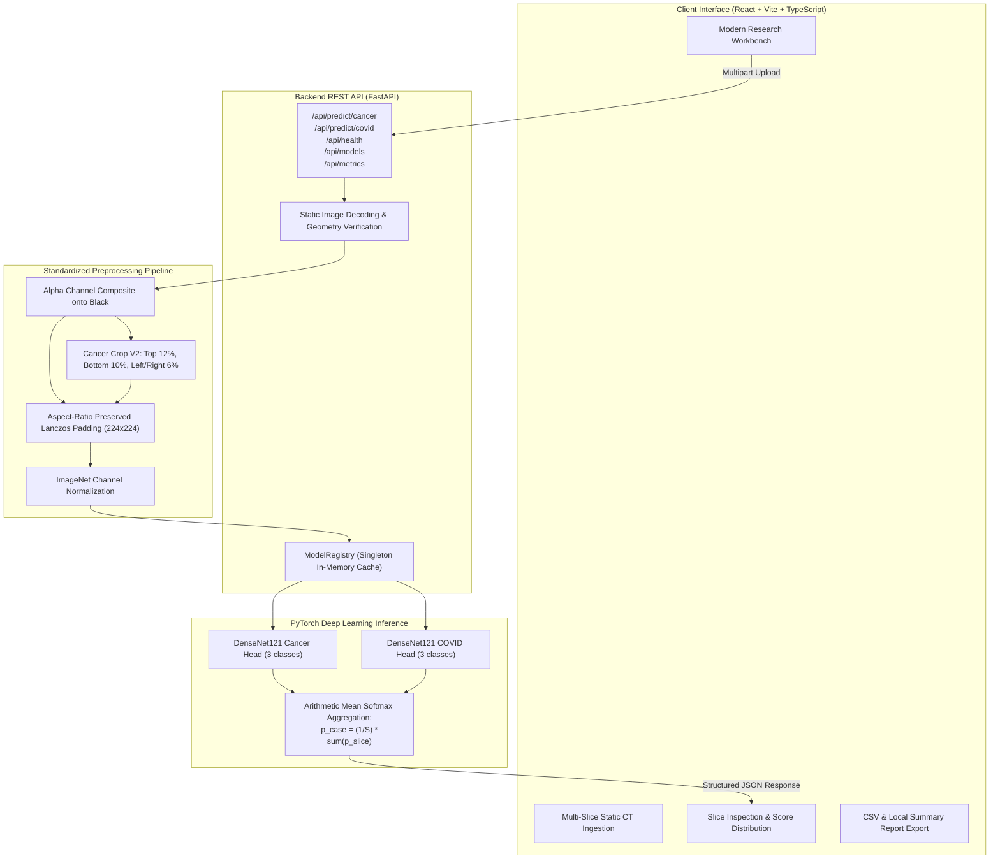

# ThoracicAI — CT Research & Classification Workbench

[](https://fastapi.tiangolo.com/)
[](https://pytorch.org/)
[](https://react.dev/)
[](https://www.typescriptlang.org/)
[](https://tailwindcss.com/)
[](#testing)

**ThoracicAI** is a full-stack, portfolio-grade clinical AI research platform designed for multi-slice chest CT classification. It integrates two independently trained ImageNet-pretrained **DenseNet-121** convolutional neural networks for thoracic disease identification, supported by leakage-group validation and arithmetic mean softmax score aggregation.

> **Research Prototype Disclaimer**: This application is strictly an academic research and algorithmic demonstration tool. It is not a certified medical device and must never be used for diagnostic determinations, clinical decision-making, or treatment planning.

---

## 1. System Architecture



---

## 2. Core Capabilities

### Dual Independent Workflows
- **Workflow A (Cancer Classification)**:
  - Checkpoint: `backend/weights/cancer/final_densenet121.pth`
  - Output Classes: `1. Benign`, `2. Malignant`, `3. Normal`
  - Preprocessing: Cancer Crop V2 (top 12%, bottom 10%, left/right 6%) to remove machine markings, orientation markers, and bed borders.
- **Workflow B (COVID / Pulmonary Disease)**:
  - Checkpoint: `backend/weights/covid/final_densenet121.pth`
  - Output Classes: `1. COVID-19`, `2. Normal`, `3. Other pulmonary disease`
  - Preprocessing: Full aspect ratio preservation with black borders (no spatial crop) to retain peripheral subpleural disease hallmarks.

### Scientific Multi-Slice Case Aggregation
Rather than majority voting on discrete hard labels, the platform calculates the **arithmetic mean of slice-level softmax probability vectors**:
$$\bar{p}_c = \frac{1}{S} \sum_{s=1}^S p(c \mid s)$$
$$\hat{y} = \arg\max_{c} \bar{p}_c$$

### Privacy by Design
- Anonymous auto-generated Case IDs (`CASE-CAN-XXXXXX`, `CASE-COV-XXXXXX`).
- No patient names, MRNs, dates of birth, or identifiers are collected or persisted.
- Uploaded scans are processed strictly in RAM and discarded immediately after inference.

### Evaluation & Benchmark Visualizer
- Interactive confusion matrices for both untouched independent test evaluation and pooled outer nested CV.
- Exact class-wise precision, recall, F1, and support metrics from verified CSV evaluation logs.
- Two-phase training convergence curves (classifier head warm-up vs full network fine-tuning).

---

## 3. Repository Structure

```
├── backend/                              # Python FastAPI + PyTorch Backend
│   ├── app/
│   │   ├── api/routes.py                 # REST endpoint implementations
│   │   ├── services/
│   │   │   ├── inference.py              # DenseNet121 inference & mean softmax aggregation
│   │   │   ├── metrics_service.py        # CSV evaluation parser
│   │   │   ├── sample_scans.py           # Synthetic CT scan generator for demos/tests
│   │   │   └── validation.py             # Format and dimension validation
│   │   ├── config.py                     # App configuration & crop parameters
│   │   ├── main.py                       # FastAPI application entrypoint
│   │   └── schemas.py                    # Pydantic data schemas
│   ├── weights/                          # Trained PyTorch model weights (.pth)
│   │   ├── cancer/final_densenet121.pth
│   │   └── covid/final_densenet121.pth
│   ├── tests/                            # Comprehensive PyTest test suite (24 tests)
│   ├── requirements.txt                  # Backend dependencies
│   └── README.md                         # Detailed backend documentation
├── frontend/                             # React 19 + TypeScript + Vite Frontend
│   ├── src/
│   │   ├── components/                   # Reusable UI components
│   │   │   ├── CaseReportModal.tsx       # Printable & exportable case report
│   │   │   ├── ConfusionMatrix.tsx       # Heatmap matrix visualizer
│   │   │   ├── DisclaimerBanner.tsx      # Research warning banners
│   │   │   ├── ImageUploader.tsx         # Drag & drop slice ingestion
│   │   │   ├── Navbar.tsx                # Header with live backend status ping
│   │   │   ├── ScoreDistributionChart.tsx# Recharts bar distribution
│   │   │   ├── SliceTable.tsx            # Per-slice inspection table
│   │   │   └── TrainingHistoryChart.tsx  # Convergence history curves
│   │   ├── pages/
│   │   │   ├── Dashboard.tsx             # Overview dashboard
│   │   │   ├── MethodologyPage.tsx       # Documentation & model card
│   │   │   ├── PerformancePage.tsx       # Official metrics & evaluation artifacts
│   │   │   └── WorkflowPage.tsx          # Dual-workflow classification runner
│   │   ├── services/api.ts               # Typed API client
│   │   ├── types/index.ts                # TypeScript interfaces
│   │   └── App.tsx                       # App router and layout
│   ├── vite.config.ts                    # Vite config with API reverse proxy
│   ├── package.json
│   └── README.md                         # Frontend documentation
├── docs/                                 # Evaluation artifacts & original model card
├── model_development/                    # Source training logs & checkpoints
├── MODEL_CARD.md                         # Comprehensive research model card
├── .gitignore
└── README.md                             # Project documentation
```

---

## 4. Getting Started

### Prerequisites
- Python 3.10+ (tested with Python 3.12)
- Node.js 18+ (tested with Node v24)
- npm 9+

---

### Step 1: Start the Backend Service

1. Open a terminal and navigate to `backend/`:
   ```bash
   cd backend
   ```
2. Install Python dependencies:
   ```bash
   pip install -r requirements.txt
   ```
3. Start the FastAPI application:
   ```bash
   python -m uvicorn app.main:app --host 127.0.0.1 --port 8000 --reload
   ```
4. Verify the backend is live:
   - Health check: `http://127.0.0.1:8000/api/health`
   - Interactive Swagger API documentation: `http://127.0.0.1:8000/docs`

---

### Step 2: Start the Frontend Application

1. Open a second terminal and navigate to `frontend/`:
   ```bash
   cd frontend
   ```
2. Install Node dependencies:
   ```bash
   npm install
   ```
3. Launch the Vite development server:
   ```bash
   npm run dev
   ```
4. Open your browser and navigate to:
   ```
   http://localhost:5173
   ```
   *(All `/api` network requests are automatically proxied by Vite to the FastAPI backend at `http://127.0.0.1:8000`).*

---

## 5. Testing & Verification

The backend includes a 24-test suite validating every critical requirement:
- Checkpoint loading & in-memory caching
- Class mapping ordering for Cancer and COVID models
- Cancer Crop V2 geometry and 224x224 tensor output
- COVID aspect-ratio padding geometry
- Alpha transparency channel compositing onto solid black
- Arithmetic mean softmax aggregation mathematics
- Single-slice warning flags
- Rejection of corrupt files, tiny dimensions (< 16x16), and unsupported file extensions
- REST endpoints (`/api/health`, `/api/models`, `/api/metrics`, `/api/predict/cancer`, `/api/predict/covid`)

Run the test suite:
```bash
cd backend
python -m pytest -v
```

---

## 6. Official Performance Benchmarks

| Metric | Cancer Model (DenseNet121) | COVID / Pulmonary Model (DenseNet121) |
| :--- | :--- | :--- |
| **Output Classes** | Benign, Malignant, Normal | COVID-19, Normal, Other pulmonary |
| **Development Cohort** | 875 images (69 leakage groups) | 3,553 images (178 leakage groups) |
| **Nested CV Pooled Macro F1** | **0.7212** | **0.8242** |
| **Nested CV Pooled Accuracy** | **76.81%** | **83.15%** |
| **Independent Test Cohort** | 198 images (13 leakage groups) | 615 images (32 leakage groups) |
| **Independent Test Accuracy** | **76.92%** | **78.13%** |
| **Independent Test Macro F1** | **0.7091** | **0.7775** |
| **Independent Test Weighted F1**| **0.7818** | **0.7810** |
| **Independent Test NLL Loss** | **0.3576** | **0.4980** |

---

## 7. License & Research Attribution

This project is released under the MIT License for academic research, education, and portfolio review.
Model checkpoints and datasets are used strictly under their respective academic fair-use terms.
