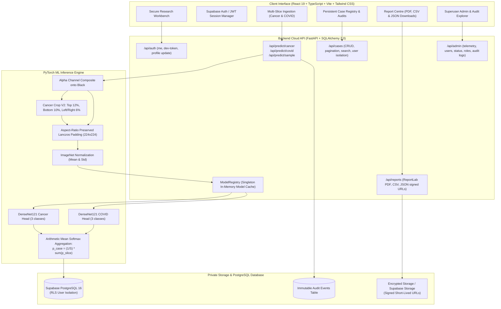

# ThoracicAI — Secure CT Research & Classification Platform

[](https://fastapi.tiangolo.com/)
[](https://pytorch.org/)
[](https://react.dev/)
[](https://www.typescriptlang.org/)
[](https://tailwindcss.com/)
[](https://docs.pytest.org/)
[](https://playwright.dev/)

**ThoracicAI** is an enterprise-grade clinical AI research platform for multi-slice chest CT classification. It integrates two independently trained ImageNet-pretrained **DenseNet-121** deep convolutional neural networks with leakage-group cross-validation, arithmetic mean softmax score aggregation, multi-user Supabase authentication, PostgreSQL Row-Level Security (RLS), and publication-grade ReportLab PDF generation.

> **Research Prototype Disclaimer**: This application is strictly an academic research and algorithmic demonstration workbench. It is **not** a certified medical device and must never be used for diagnostic determinations, clinical decision-making, or treatment planning. Softmax outputs represent uncalibrated neural network activations, not clinical diagnostic probabilities.

---

## 1. System Architecture



---

## 2. Machine Learning Models & Workflows

The platform deploys two strictly independent DenseNet-121 networks trained on distinct cohorts with separate label spaces:

### Workflow A: Thoracic Cancer Classification
- **Model Checkpoint**: `backend/weights/cancer/final_densenet121.pth`
- **Output Classes (exact order)**:
  1. `Benign`
  2. `Malignant`
  3. `Normal`
- **Preprocessing Pipeline**:
  - RGB conversion (compositing transparent PNGs onto black background)
  - **Cancer Crop V2**: Discards top 12%, bottom 10%, left 6%, right 6% to eliminate scanner bed borders and metadata markers
  - Lanczos aspect-ratio preserved padding to 224 × 224
  - Standard ImageNet channel normalization (`mean=[0.485, 0.456, 0.406]`, `std=[0.229, 0.224, 0.225]`)
- **Verified Benchmarks**:
  - Nested Group CV Pooled Macro F1: **0.7212**
  - Independent Test Group Accuracy: **76.92%** (10/13 groups)
  - Independent Test Macro F1: **0.7091**
  - Independent Test Weighted F1: **0.7818**
  - Independent Test Negative Log-Likelihood: **0.3576**

### Workflow B: COVID / Pulmonary Disease Classification
- **Model Checkpoint**: `backend/weights/covid/final_densenet121.pth`
- **Output Classes (exact order)**:
  1. `COVID-19`
  2. `Normal`
  3. `Other pulmonary disease`
- **Preprocessing Pipeline**:
  - RGB conversion
  - **Aspect-Ratio Preservation**: No spatial cropping to ensure peripheral subpleural disease hallmarks remain intact
  - Centered padding with black borders to 224 × 224 using Lanczos interpolation
  - Standard ImageNet channel normalization
- **Verified Benchmarks**:
  - Nested Group CV Pooled Macro F1: **0.8242**
  - Independent Test Group Accuracy: **78.13%** (25/32 groups)
  - Independent Test Macro F1: **0.7775**
  - Independent Test Weighted F1: **0.7810**
  - Independent Test Negative Log-Likelihood: **0.4980**

### Arithmetic Mean Softmax Aggregation
For multi-slice CT series, case classification is computed by the arithmetic mean of per-slice softmax vectors:
$$\bar{p}_c = \frac{1}{S} \sum_{s=1}^S p(c \mid s)$$
$$\hat{y}_{\text{case}} = \arg\max_{c} \bar{p}_c$$

---

## 3. Production SaaS Architecture & Capabilities

1. **Multi-User Authentication**:
   - Supabase Auth integration with local mock/dev fallback for offline evaluation.
   - JWT decoding and independent cryptographic signature & expiry validation.
   - Role-Based Access Control: `RESEARCHER` and `ADMIN`.
2. **Persistent Case Registry**:
   - Systematic case reference format: `CASE-CAN-XXXXXX` and `CASE-COV-XXXXXX`.
   - Stores aggregated class score distributions, slice-level breakdown, and latency metrics.
   - Strict Row-Level Security (RLS): Researchers can only view and manage their own cases.
3. **Publication-Grade Report Generation**:
   - **ReportLab PDF Engine**: Multi-page publication reports with dynamic page numbering ("Page X of Y"), aggregated findings, class distributions, full slice tables, and clinical disclaimers.
   - **CSV Export**: Clean tabular export of slice-level predictions and score vectors.
   - **JSON Schema**: Versioned machine-readable payload (`https://thoracicai.local/schemas/report-v1.json`).
4. **Private Document Storage**:
   - Supabase Storage support with short-lived signed URLs (15-minute expiration) and encrypted local filesystem fallback.
5. **Administrative Console**:
   - System telemetry (PyTorch device, loaded models, compute memory).
   - User governance: activate, deactivate, and promote/demote roles.
   - Immutable audit event logging (`audit_events` table).
6. **Privacy by Design**:
   - **Zero Raw Image Storage**: Uploaded CT slices are processed purely in-memory as PyTorch tensors and destroyed upon request completion.
   - **No Protected Health Information (PHI)**: No patient names, MRNs, or identifying information are captured.

---

## 4. Local Development & Testing

### Running the Backend

```bash
cd backend
python -m venv .venv
source .venv/bin/activate  # or .venv\Scripts\activate on Windows
pip install -r requirements.txt
python -m uvicorn app.main:app --host 127.0.0.1 --port 8000 --reload
```

### Running the Frontend

```bash
cd frontend
npm install
npm run dev
```

Open `http://localhost:5173` in your browser.

### Automated Test Suites

**1. PyTest Backend Suite (44 Tests)**:
```bash
cd backend
python -m pytest -v
```
Covers model caching, inference aggregation, file validation, authentication, JWT verification, case management, report generation, user isolation, and admin governance.

**2. Playwright End-to-End Suite (7 Tests)**:
```bash
cd frontend
npx playwright test
```
Covers full browser journeys: landing page disclaimer, institutional user registration & sign-in, account settings & profile updates, admin Governance Center access, cancer and COVID multi-slice inference, PDF report generation, Case Registry inspection, Report Centre document verification and streaming downloads, and benchmark verification.

### Administrator Setup & Role Management

Administrator privileges are strictly controlled via setup utilities rather than automatic elevation:

1. **Configure Administrator Email**:
   Specify `ADMIN_EMAIL=your-admin@institution.org` in `backend/.env`.
2. **Assign Role via CLI**:
   Execute the dedicated bootstrap utility:
   ```bash
   python -m app.cli.set_admin your-admin@institution.org
   ```
3. **Controlled Role Revocation**:
   Administrator access can be demoted to `RESEARCHER` or deactivated at any time via the Admin Governance Center without automatic re-promotion upon login.

---

## 5. Cloud Deployment

See [DEPLOYMENT.md](file:///c:/Project/AI-Based%20Thoracic%20Disease%20Detection%20Using%20Chest%20CT%20Images/thoracicai_antigravity_handoff/DEPLOYMENT.md) for step-by-step instructions:
- **Database & Auth**: Supabase PostgreSQL 16 with `migrations/001_initial_schema.sql`
- **Backend Service**: Render Docker Web Service (`backend/Dockerfile`, `render.yaml`)
- **Frontend SPA**: Vercel (`frontend/vercel.json`)
- **Local Multi-Container**: `docker-compose.yml`

---

## 6. License & Disclaimers

ThoracicAI is released strictly for academic evaluation and research purposes. It must not be deployed in clinical environments or used for human diagnostic determinations.
